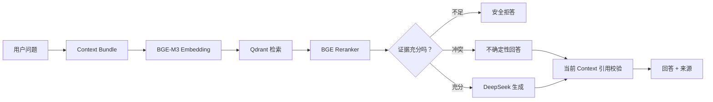

# Obsidian Learning Agent

<p align="center">
  <strong>把分散在 Obsidian 与本地文档中的知识，变成可检索、可引用、可复盘的个人学习系统。</strong>
</p>

<p align="center">
  Local-first · Evidence-aware · Human-in-the-loop
</p>

<p align="center">
  
  
  
  
  
  
</p>

---

Obsidian Learning Agent 是一个面向个人知识库的本地 RAG 学习助手。它读取你明确授权的 Obsidian Markdown 和上传文档，通过本地 Embedding、Qdrant 检索、BGE Reranker 与 DeepSeek 生成带来源的回答，并把目标、学习状态、Session、复盘和受控资料更新串成一条完整学习链路。

它不追求“什么都自动做”。项目更关注三件事：

- **回答有依据**：证据不足时拒答，资料冲突时表达不确定性，引用必须来自当前 Context。
- **数据边界明确**：Vault 默认只读；写回必须经过 Proposal、Diff、人工审批和写前 Hash 校验。
- **本地运行可维护**：提供 Windows 诊断、一键启动、状态检查、安全预热、精确停止和 Dry Run 清理。

## 你可以用它做什么

| 场景 | 能力 |
| --- | --- |
| 知识库问答 | 检索上传文档与 Obsidian 笔记，生成带 `[来源N]` 引用的回答 |
| 安全问答 | Evidence Sufficiency Gate 在证据不足时于 LLM 前拒答 |
| 冲突识别 | 对相互矛盾的资料给出不确定性说明，并引用冲突来源 |
| 连续学习 | 将学习目标、掌握度、当前问题、Session 和主动复盘组合起来 |
| 官方资料审计 | 手动抓取公开来源，生成 Evidence Proposal，经审批后原子写回笔记 |
| RAG 评估 | 使用本地固定数据集比较检索、引用、安全性、延迟与模型调用 |
| 本地运维 | 在 Windows 上诊断 MySQL/Qdrant/Vault/模型并一键启停 |

## 页面入口

应用启动后访问：

| 页面 | 地址 | 用途 |
| --- | --- | --- |
| 首页 | `http://127.0.0.1:8000/` | 系统状态、快捷入口与最近运行 |
| 学习工作台 | `/learning` | Session、目标、学习状态、问答与复盘 |
| 官方资料 | `/official` | 来源提醒、Audit、Proposal 与审批 |
| Agent 控制台 | `/agent` | Memory、Tool、MCP、Run History 与清理 |
| RAG 评估 | `/agent/rag-evaluation` | 数据集、实验、Profile 与评估报告 |
| 管理后台 | `/admin` | 文档、索引、检索调试与 QA History |
| 详细诊断 | `/system/status` | 只读系统健康信息 |

## 系统如何工作



核心数据关系：

```text
Obsidian Vault ── Markdown 事实源
       │
       ├── MySQL：元数据、目标、Session、历史、审批与审计
       ├── Qdrant：Chunk 向量与检索 Payload
       └── FastAPI + LangGraph：检索、门禁、回答与受控写回
```

Embedding、Reranker、Qdrant Client 和编译后的 RAG Graph 都在进程内复用。Reranker 支持 `auto/cpu/cuda`；CUDA 加载或推理失败时自动回退 CPU，不让设备问题阻断 RAG。

## Windows 快速开始

### 环境要求

- Windows PowerShell 5.1+
- Python 3.11+
- Windows 服务 `MySQL80`
- Docker Desktop（仅用于 Qdrant）
- DeepSeek API Key
- 可选：支持 CUDA 的 NVIDIA GPU 与 Torch

标准运行关系：

```text
Windows MySQL80 :3306
Docker Qdrant   :6333 / :6334
Local FastAPI   :8000
```

> 一键脚本只会启动 Compose 中的 `qdrant`，不会启动 Docker MySQL，也不会停止无关进程。

### 1. 克隆并安装

```powershell
git clone https://github.com/Kirito161718/Obsidian-Learning-Agent.git
cd Obsidian-Learning-Agent

python -m venv .venv
.\.venv\Scripts\Activate.ps1
pip install -r requirements.txt
```

### 2. 配置环境

```powershell
Copy-Item .env.example .env
```

编辑 `.env`，至少配置 MySQL、DeepSeek 和 Obsidian Vault。`.env` 已被 Git 忽略；不要提交真实密码或 Token。

首次初始化数据库：

```powershell
alembic upgrade head
```

### 3. 诊断并启动

```powershell
.\scripts\doctor.ps1
.\scripts\start.ps1 -Prewarm
.\scripts\status.ps1
```

停止应用：

```powershell
.\scripts\stop.ps1
```

默认不会停止 MySQL80、Qdrant 或 Docker Desktop。只有显式执行 `.\scripts\stop.ps1 -StopQdrant` 才会停止本项目 Qdrant 服务。

完整说明见 [本地运行与运维](docs/LOCAL_OPERATIONS.md)。

## 一个典型的 RAG 请求

```powershell
$body = @{
    question     = "LangGraph 在这个项目中承担什么职责？"
    top_k        = 5
    source_types = @("obsidian_note")
} | ConvertTo-Json

Invoke-RestMethod `
    -Method Post `
    -Uri "http://127.0.0.1:8000/rag/ask" `
    -ContentType "application/json" `
    -Body $body
```

回答包含：

- `answer`：带 `[来源N]` 的答案、安全拒答或不确定性说明；
- `sources`：当前回答实际使用的 Chunk；
- `answer_policy`：`answer`、`abstain` 或 `answer_with_uncertainty`；
- `context_manifest`：本次请求应用的有限上下文摘要；
- `run_id`：可用于本地运行诊断与审计。

只想检查检索、不调用答案模型或写 QA History 时，使用 `POST /rag/retrieve`。

## 安全设计

### Evidence Sufficiency Gate

系统根据候选存在性、相似度、Top-k 均值、来源覆盖、Context 有效性和检索一致性做确定性判断：

- `answer`：证据足够，可以生成答案；
- `abstain`：证据不足，在调用答案模型前拒答；
- `answer_with_uncertainty`：资料存在冲突或不足，回答必须明确表达不确定性。

### 引用真实性

生成后的引用只能指向当前 Context。冲突回答必须覆盖多个冲突来源；校验失败时返回安全说明，不额外调用 LLM“修补”或伪造引用。

### Vault 写回

Vault 的通用扫描与检索保持只读。官方资料更新必须经过：

```text
手动登记来源
→ 手动 Audit
→ Snapshot 与确定性 Diff
→ Evidence Proposal
→ 人工审批
→ 写前 Hash stale 校验
→ Before Version
→ 原子写入
→ 单笔记 Reindex
```

网页、PDF 和模型输出始终按不可信数据处理，不能改变系统规则、审批风险或目标路径。

### 敏感信息

- `.env`、模型、上传文件、运行数据和真实评估集均被 Git 忽略；
- `/health` 保持轻量，`/system/status` 不加载模型、不调用 DeepSeek；
- 状态接口不返回 API Key、数据库密码或 Vault 绝对路径；
- LangSmith 默认使用脱敏输入，真实私有评测 Case 禁止上传。

## 本地清理

默认只执行 Dry Run：

```powershell
.\scripts\cleanup.ps1
```

确认候选列表后才允许实际清理：

```powershell
.\scripts\cleanup.ps1 -Apply
```

脚本只处理项目内可重建缓存、临时文件、过期普通日志、过期 PID 和允许清理的普通运行历史，不会清理 Vault、生产 Qdrant Collection、QA History、Session、Proposal、Approval、Note Version 或 Active Profile。

## 测试

```powershell
.\.venv\Scripts\python.exe -m pytest -q
.\.venv\Scripts\python.exe -m compileall app

node --check app/static/admin.js
node --check app/static/learning.js
node --check app/static/agent.js
node --check app/static/official_sources.js
node --check app/static/rag_evaluation.js
```

阶段 9 产品化定向测试：

```powershell
.\.venv\Scripts\python.exe -m pytest tests/test_stage9_productization.py -q
```

## 从 RAG MVP 到 Learning Agent

项目按可验证阶段逐步演进，保留提交与 Pull Request 记录，便于查看每个阶段的目标、约束和工程取舍。

| 阶段 | 主要成果 |
| --- | --- |
| 1 | 文档上传、解析、Chunk、Embedding、Qdrant 与基础问答 |
| 2 | Obsidian Vault 只读扫描、增量索引与结构化 Markdown |
| 3 | 学习目标、状态、Session、上下文选择与主动复盘 |
| 4 | 分层 Memory、Context Bundle、Tool Registry、Policy 与 Audit |
| 5 | 官方 MCP SDK、只读 Server/Client 与统一工具风险策略 |
| 6 | 官方来源 Audit、Proposal、Approval、Version 与原子写回 |
| 7 | LangSmith 安全观测、固定数据集评估、消融与安全门禁 |
| 8 | 激活 `rag-safe-v1`、来源提醒、首页与统一交互体验 |
| 9 | 性能硬化、CUDA→CPU 回退、模型复用、诊断与 Windows 一键运行 |

## 文档导航

| 文档 | 内容 |
| --- | --- |
| [项目架构与面试材料](docs/PROJECT_OVERVIEW_AND_INTERVIEW.md) | 核心架构、技术难点、工程取舍与项目介绍 |
| [本地运行与运维](docs/LOCAL_OPERATIONS.md) | 配置、启停、预热、诊断、清理、备份与恢复 |
| [RAG 安全与性能](docs/RAG_SAFETY_AND_PERFORMANCE.md) | Evidence Gate、引用门、性能指标与设备实测 |
| [RAG 评估](docs/RAG_EVALUATION.md) | 数据集、指标、实验运行与晋级门禁 |
| [Obsidian 接入](docs/OBSIDIAN_VAULT_INTEGRATION.md) | Vault 扫描、解析、增量索引与边界 |
| [学习工作台](docs/LOCAL_LEARNING_WORKSPACE.md) | Session、目标、状态、问答和复盘 |
| [Memory 与工具基础](docs/MEMORY_CONTEXT_TOOL_FOUNDATION.md) | Context、Memory、Tool Registry 与审计 |
| [只读 MCP](docs/READ_ONLY_MCP_INTEGRATION.md) | MCP Server/Client、传输与安全策略 |
| [官方资料审计](docs/OFFICIAL_SOURCE_AUDIT_AND_APPROVAL.md) | 来源抓取、Proposal、审批、版本和写回 |
| [LangSmith 观测](docs/LANGSMITH_OBSERVABILITY.md) | Trace、脱敏、失败降级与数据边界 |

## 当前边界

为了保持可验证性，项目当前没有实现：

- Hybrid Search、MMR 或 Parent-Child Retrieval；
- 模型自主工具调用、多智能体 Planner/Executor；
- 后台自动抓取或任务调度；
- Obsidian 原生插件或新的前端框架；
- 云端部署和完整插件生命周期管理；
- 持久化 Query Cache。

这些不是遗漏，而是当前阶段的主动取舍：先把引用、安全、人工审批、评估和本地运维做扎实，再扩展新的自动化能力。

---

如果你正在寻找一个“功能越多越好”的聊天机器人，这个项目可能不是最短路径；如果你关心本地知识库如何做到**证据可追踪、写入可审批、失败可降级、实验可复现**，这里记录了一套完整的工程实践。
